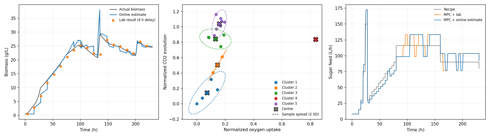
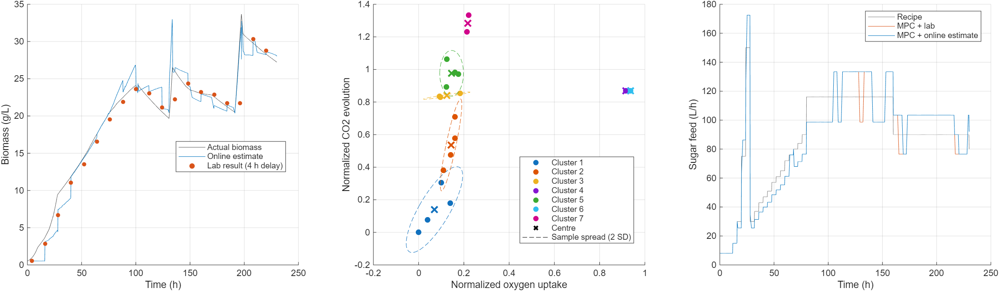

# Fermentation demo

Small seminar example using IndPenSim. A soft sensor learns biomass from delayed lab samples. MPC uses the estimate to adjust the sugar feed.

There are three plots: biomass estimation, clusters and feed control. The comparison is recipe vs MPC with lab results vs MPC with the online estimate.

Python:



MATLAB:



```sh
python download_simulators.py
python python/demo.py
```

```matlab
demo_matlab
```

## Notes

- Lab: 12 h sampling, 4 h delay.
- Ellipses show sample spread.
- MPC: 8 h horizon, 4 h updates, oxygen limits.
- Python and MATLAB results can differ.

